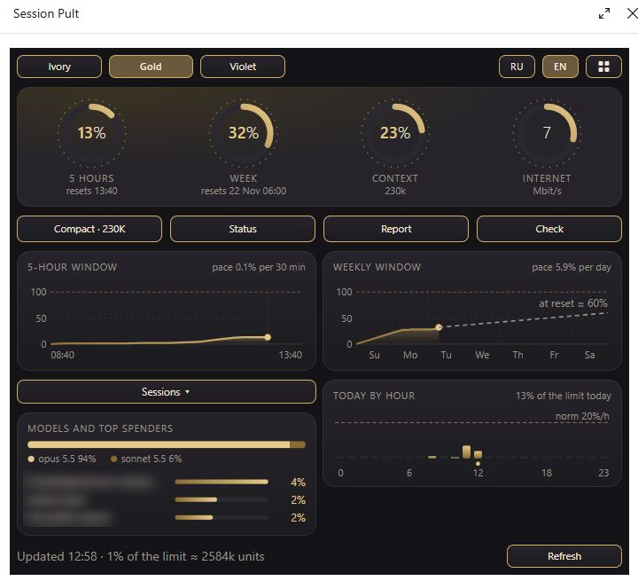
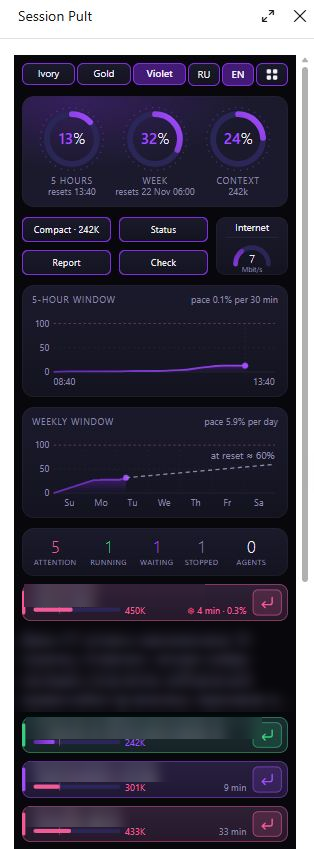
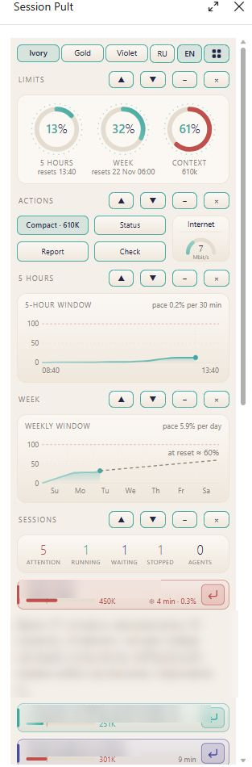

# Session Pult for Claude Code

[](LICENSE)
[](https://code.claude.com/docs/en/plugins/mods)

[Русская версия](README.ru.md)

A control panel that sits next to your Claude chat. It shows how much of your 5-hour and weekly limits you have used, how full this session's context is, and which of your sessions are running, which are waiting for you, and which are about to lose their prompt cache.

I built it for myself once I had more than five sessions running in parallel and my limit kept running out before the reset. "Pult" is Russian for a control panel.



## Install

Open Claude Code in a terminal and run:

```
/plugin install session-pult --marketplace denilis/claude-session-pult
```

Answer `y` when asked about the new marketplace, then choose **Install for you** (user scope), so the panel also shows up in the Claude desktop app. Start a new session and the panel appears on the right. If it doesn't, type `/pult`.

The panel follows your system language: Russian on a Russian system, English everywhere else. Press **RU** or **EN** in the top row to choose for yourself; that choice is saved for all sessions. Compact and the prompt buttons send their instructions in the panel language, and the compaction summary is written in it.

## Requirements

- Claude Code 2.1.287 or later in the terminal, or the Claude desktop app (Code tab), where mods work from 2.1.286.
- A Claude subscription. The panel is built around its 5-hour and weekly limits and its one-hour prompt cache; with an API key the cache usually lives 5 minutes.
- Python 3 for the session list, the charts and the speed test. Without it, the limit rings and the buttons still work.
- Windows. On macOS the panel runs too, but notifications stay inside Claude and session rows don't open on click.

## What's on the panel

The top row has buttons for the theme (Ivory, Gold, Violet), the language (RU, EN) and the block layout. All three are remembered across sessions.

You can rearrange the blocks. Press the four-squares icon in the top right corner: each block gets up and down arrows, a collapse button and a close button. A collapsed block stays as a strip with its name; click it to expand. Closed blocks come back through buttons at the bottom of the panel, next to Reset and Done. The app doesn't support drag and drop, so it's arrows only.

Three rings show the 5-hour limit, the weekly limit and this session's context. Below them:

- **Compact** shrinks the context into a summary that keeps the goal, the decisions and the file paths.
- **Status, Report, Check** are one-click prompts to Claude: what has been done, a wrap-up of the task, a check of the result before you send it anywhere.

Next to the buttons, a small gauge shows your download speed. One measurement serves all sessions: it runs every 30 minutes and when you press Refresh, and uses up to 12 MB.

`/new-sheet` gives you a clean slate: Claude writes the project memory to `PROJECT_MEMORY.md`, the context is cleared, then Claude reads the memory back and tells you in one line where you left off.

Further down: forecasts of when the 5-hour and weekly limits will run out, today's sessions, usage by hour and each model's share.

## Wide panel

The layout follows the panel's width. A narrow panel shows one column. At about 600 px the blocks move into two columns, at about 950 px into three. The limit rings with the speed gauge and the four buttons span the full width; the other blocks keep your order, each going into the shorter column. Font and rings stay the same size, and changing only the panel height doesn't change the layout. Columns work in the Claude desktop app for Windows and macOS; in the terminal and VS Code the panel stays a single column.

## Session rows

Click a session row to open it in the Claude app (that's what the Enter badge on the right means). This works for sessions started in the app; terminal sessions show their status instead. You reply in the chat itself.

The row color shows the status. The colors below are for the default Gold theme; Ivory and Violet use their own palette.

- **Red**: needs you. It asked a question, hit a limit, or its cache is about to go cold
- **Yellow**: waiting
- **Green**: running
- **Gray**: stopped

A session that waits for you shows what it is waiting for. Sessions with a context over 100K tokens whose cache goes cold in less than 15 minutes move to the top, with the cost of being late shown as a percentage of your limit.

<p>
  
  
</p>

Left: the session list in the Violet theme. Right: rearranging blocks in the Ivory theme. Session titles are blurred.

## What it does on its own

- **Warns before the cache goes cold.** On a Claude subscription the prompt cache lives for an hour: after an hour of silence, the next reply re-reads the whole context at full price. If the context is over 100K tokens, a bar with a Compact button appears above the prompt fifteen minutes before that.
- **Moves agents to Sonnet.** When the main session runs on Opus, built-in subagents and your own agents in `~/.claude/agents` that don't set a model run on Sonnet instead.
- **Notifies you** when a limit passes 80% and when the forecast says it will run out before the reset.
- **Tells you when another session finishes a reply** and is waiting for you while you are busy in Claude. Click the notification to open it. When the window is minimized, the app shows the notification itself.

## Data and privacy

Everything is computed on your computer: the panel reads session logs in `~/.claude/projects` and the app's session files, and sends nothing anywhere. The only network access is the speed test, which downloads a test file from Cloudflare. It runs Python (session list, charts, speed test), PowerShell (Windows notifications and the system language), rundll32 (opening sessions) and, on macOS, `defaults` (the system language). It keeps a small cache in `~/.claude/cache/session-pult.json`.

The panel spends tokens only when you ask it to: the Compact, Status, Report and Check buttons and `/new-sheet`.

## Session Pult and claude-monitor

[Claude Code Usage Monitor](https://github.com/Maciek-roboblog/Claude-Code-Usage-Monitor) (`claude-monitor`) is a popular terminal tool for tracking usage. The two solve different problems (compared with claude-monitor 4.0.0):

- Session Pult is a panel next to the chat, made for the Claude desktop app. claude-monitor is a terminal app you run in a separate window, on Windows, macOS and Linux.
- Session Pult shows the 5-hour and weekly limits as the app reports them. By default claude-monitor estimates limits from your own history; official figures need its statusline hook or an opt-in API call.
- Session Pult tracks live sessions (running, waiting, needs you) and warns before the prompt cache goes cold. claude-monitor has what the panel doesn't: cost in dollars, burn rate in tokens and dollars per minute, daily and monthly reports, JSON and CSV export.

If you live in the terminal and want cost reports, claude-monitor is the better fit. If you run several sessions in the Claude app, try the panel. The two can run side by side.

## Uninstall

```
/plugin uninstall session-pult
```

## Feedback

Bugs and ideas are welcome in [Issues](https://github.com/denilis/claude-session-pult/issues). If the panel is useful to you, a star helps other people find it.

## License

[MIT](LICENSE)
