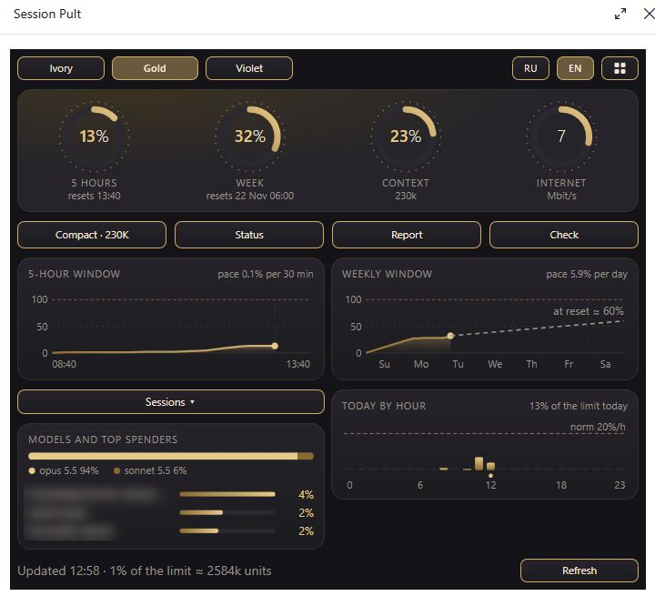
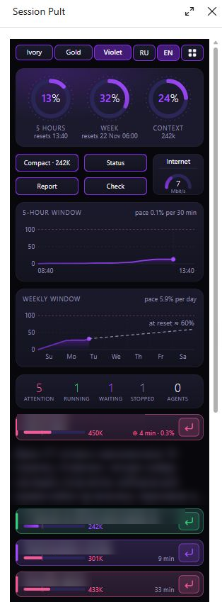
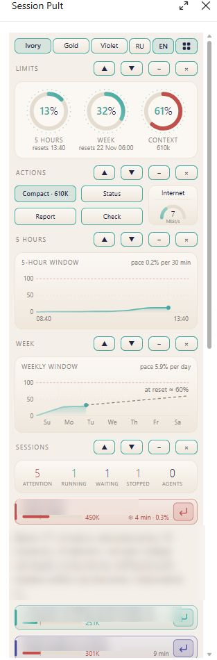

# Пульт сессий для Claude Code

[English version](README.md)

Панель рядом с чатом Claude. На ней видно, сколько израсходовано из лимитов, сколько места занимает контекст, какие сессии работают и какие ждут вашего ответа. Написал ее для себя, когда параллельных сессий стало больше пяти и лимит начал кончаться раньше времени.



## Установка

Откройте Claude Code в терминале и введите:

```
/plugin install session-pult --marketplace denilis/claude-session-pult
```

На вопрос о новом маркетплейсе ответьте `y`, затем выберите установку для себя (Install for you): так пульт будет доступен и в приложении Claude. Откройте новую сессию: пульт появится справа. Если панели нет, наберите `/pult`.

Если вы ставили пульт раньше из архива, сначала удалите папку `%USERPROFILE%\.claude\skills\session-pult`, иначе загрузятся два пульта.

## Что нужно

- Claude Code 2.1.287 или новее в терминале либо приложение Claude (вкладка Code), где моды работают с версии 2.1.286.
- Подписка Claude. Пульт рассчитан на ее пятичасовой и недельный лимиты и часовой кэш. С API-ключом кэш обычно живет 5 минут.
- Python 3 для списка сессий, графиков и замера скорости. Без него работают кольца лимитов и кнопки.
- Windows. На Mac пульт тоже запустится, но уведомления будут только внутри Claude, а строки сессий не будут открываться нажатием.

## Что на панели

Вверху кнопки оформления (Кость, Золото, Фиолет), языка (RU, EN) и настройки блоков. Оформление, язык и расстановка запоминаются для всех сессий. Пока язык не выбран кнопкой, пульт берет его из системы: на русской системе он русский, на любой другой английский.

Блоки можно расставить по-своему. Нажмите значок с четырьмя квадратами вверху справа: над каждым блоком появятся стрелки вверх и вниз, кнопки свернуть и закрыть. Свернутый блок остается полоской с названием, нажатие разворачивает его. Закрытые блоки возвращаются кнопками внизу панели, там же кнопки «Как было» и «Готово». Перетаскивать блоки мышью приложение не позволяет. Расстановка запоминается для всех сессий.

Кольца показывают пятичасовой лимит, недельный лимит и контекст этой сессии. Под ними кнопки:

- **Сжать.** Сжимает контекст в сводку, которая сохраняет цель, решения и пути к файлам.
- **Статус, Итог, Проверка.** Готовые просьбы к Claude: что сделано, итог по задаче, проверка результата перед отправкой.

Справа от кнопок квадрат со скоростью загрузки на шкале. Замер идет раз в 30 минут и по кнопке «Обновить», один на все сессии, и тратит до 12 МБ трафика.

Команда `/new-sheet` начинает с чистого листа: Claude записывает память проекта в `PROJECT_MEMORY.md`, контекст очищается, затем Claude читает память и одной строкой говорит, на чем остановились.

Ниже прогнозы, когда кончатся пятичасовой и недельный лимиты, список сегодняшних сессий, расход по часам и доля каждой модели.

## Широкая панель

Панель подстраивается под ширину. В узкой все блоки идут одной колонкой. Если расширить панель примерно до 600 точек, блоки встают в две колонки, от 950 точек в три. Кольца лимитов вместе со скоростью интернета и четыре кнопки тянутся на всю ширину, остальные блоки идут в вашем порядке, каждый в ту колонку, что короче. Шрифт и кольца при этом остаются прежнего размера. Если поменять только высоту панели, раскладка не меняется. Колонки есть только в приложении Claude для Windows и Mac, в терминале и VS Code панель как раньше.

## Строка сессии

Строка сессии нажимается целиком: сессия откроется в приложении Claude, на это указывает прямоугольник со знаком Enter справа. Так открываются сессии, запущенные в приложении; у терминальных вместо значка Enter подписан статус. Отвечают уже в самом чате. Цвет строки показывает статус (цвета для оформления Золото, в оформлениях Кость и Фиолет свои): красный значит нужны вы (задан вопрос, сессия уперлась в лимит или кэш вот-вот остынет), желтый ждет, зеленый работает, серый остановлена.

- Под сессией, которая ждет вас, написано, чего она ждет.
- Сессии с контекстом больше 100 тыс. токенов, у которых кэш остынет меньше чем через 15 минут, поднимаются наверх, рядом цена опоздания в процентах лимита.

<p>
  
  
</p>

Слева список сессий в оформлении Фиолет, справа настройка блоков в оформлении Кость. Названия сессий размыты.

## Что пульт делает сам

- Предупреждает об остывающем кэше. На подписке Claude кэш живет час: после часа перерыва следующий ответ перечитывает весь контекст по полной цене. Если контекст больше 100 тыс. токенов, за 15 минут до этого над полем ввода появляется полоса с кнопкой «Сжать».
- Переводит на Sonnet встроенных агентов и ваших агентов из `~/.claude/agents`, у которых не задана модель, когда основная сессия работает на Opus.
- Присылает уведомление, когда лимит прошел 80% и когда по прогнозу кончится раньше сброса.
- Сообщает, что другая сессия ответила и ждет вас, пока вы заняты в Claude. Нажмите на уведомление, и она откроется. Когда окно свернуто, такое уведомление показывает само приложение.

## Данные и расход

Пульт считает все на вашем компьютере: читает журналы сессий в `~/.claude/projects` и файлы сессий приложения. Никуда их не отправляет. В интернет пульт выходит только для замера скорости: скачивает пробный файл у Cloudflare. Для работы он запускает Python (список сессий, графики, замер скорости), PowerShell (уведомления Windows и язык системы), rundll32 (открытие сессий), а на Mac еще `defaults` (язык системы). Небольшой кэш пульт хранит в `~/.claude/cache/session-pult.json`.

Токены тратятся, только когда вы сами просите: кнопки «Сжать», «Статус», «Итог», «Проверка» и команда `/new-sheet`.

## Пульт и claude-monitor

[Claude Code Usage Monitor](https://github.com/Maciek-roboblog/Claude-Code-Usage-Monitor) (`claude-monitor`) это популярная программа для учета расхода в терминале. У пульта и claude-monitor разные задачи (сравнение с версией 4.0.0):

- Пульт сделан как панель рядом с чатом для приложения Claude. claude-monitor запускается в терминале отдельным окном и работает на Windows, macOS и Linux.
- Пульт показывает пятичасовой и недельный лимиты так, как их видит приложение. claude-monitor по умолчанию оценивает лимиты по вашей же истории, а официальные цифры получает через свою строку состояния или запрос к API, который включают вручную.
- Пульт следит за живыми сессиями (работает, ждет, нужны вы) и предупреждает об остывающем кэше. У claude-monitor есть то, чего нет в пульте: стоимость в долларах, темп в токенах и долларах в минуту, отчеты по дням и месяцам, выгрузка в JSON и CSV.

Если вы работаете в терминале и вам нужны отчеты о стоимости, лучше подойдет claude-monitor. Если у вас несколько сессий в приложении Claude, попробуйте пульт. Обе программы можно запускать одновременно.

## Удаление

```
/plugin uninstall session-pult
```

## Обратная связь

Об ошибках и идеях пишите в [Issues](https://github.com/denilis/claude-session-pult/issues). Если пульт вам пригодился, поставьте звезду: так его быстрее найдут другие.

## Лицензия

[MIT](LICENSE)
